# 🛠️ Awesome Developer Tools & Code Analysis

  
  
  
  
  
  

  <strong>Curated Directory of Developer Tools, SAST Security Scanners, AST Code Intelligence &amp; Quality Engineering Platforms</strong> 
  <em>Benchmarked with Commercial Pricing, Free Tier Allowances, Open-Source Star Rankings &amp; Market Dynamics</em>

---

## 🧭 Executive Summary & SEO Keywords

> **Keywords:** *Static Code Analysis (SAST), Code Quality Gates, AST Pattern Matching, DevSecOps Tooling, Linter Suites, Architectural Technical Debt, Cyclomatic Complexity, Code Property Graph (CPG), AI Code Autofix, Clean Code, Tree-sitter, Software Composition Analysis (SCA).*

This repository tracks the premier **SaaS/hosted platforms** and **open-source developer tools** for **Code Analysis and Quality Engineering**. These platforms audit source code for security vulnerabilities, software architecture decay, cognitive and cyclomatic complexity, code duplication, and maintainability regressions across IDEs, AI coding agents, pull requests, and CI/CD pipelines.

---

## 📑 Table of Contents

- [📈 Sector Overview & Market Dynamics](#-sector-overview--market-dynamics)
- [🏢 SaaS & Hosted Platforms](#-saas--hosted-platforms)
- [🔓 Open-Source GitHub Projects](#-open-source-github-projects)
- [🤝 How to Contribute](#-how-to-contribute)
- [💖 Support & Sponsorship](#-support--sponsorship)
- [📜 Star History](#-star-history)
- [⚖️ Disclaimer](#️-disclaimer)

---

## 📈 Sector Overview & Market Dynamics

The global Static Code Analysis & SAST market is estimated at approximately **$1.5B – $2.1B in 2026**, growing at a CAGR of ~17% to 22% propelled by DevSecOps automation, AI-assisted code generation, and compliance mandates. The market is **moderately concentrated yet intensely competitive**: an upper tier of enterprise AppSec and quality incumbents (Snyk, SonarSource, Veracode, Black Duck, Checkmarx) commands major regulated enterprise contracts, coexisting with a vibrant, fragmented long tail of developer-first and open-source-driven innovators.

---

## 🏢 SaaS & Hosted Platforms

| Company / Product | Company Size (Valuation / Revenue) | Starting Tier Pricing | Free Tier / Trial Limits | Description |
| :--- | :--- | :--- | :--- | :--- |
| **[Snyk Code](https://snyk.io)** | **$7.4B valuation** (~$300M+ ARR) | $25 / contributing developer / month (Team plan; 5-dev min) | Free forever: 100 SAST tests/mo, 200–400 SCA tests/mo, unlimited users | Real-time AI-powered Static Application Security Testing (SAST) platform delivering instant IDE diagnostics, semantic data-flow tracing, and automated pull-request fixes. |
| **[SonarQube Cloud (SonarCloud)](https://sonarsource.com)** | **$4.7B valuation** (~$100M–$140M revenue) | $34 / month (Team plan for up to 100,000 LOC) | Free forever: Up to 50,000 LOC for private repos; unlimited LOC for public open-source repos | Cloud continuous code quality and security analysis service offering Clean-as-You-Code quality gates, cognitive complexity tracking, taint analysis, and PR decoration across 30+ languages. |
| **[Veracode Static Analysis](https://veracode.com)** | **$2.5B valuation** (~$200M–$225M ARR) | ~$15,000 / year (entry application tier; unlimited devs) | No self-service free tier or trial; guided enterprise proof-of-concept (PoC) demo available upon request | Enterprise cloud application security suite performing binary and source-level static code analysis, compliance reporting, and IDE remediation guidance. |
| **[Synopsys / Black Duck Coverity Cloud](https://blackduck.com)** | **$2.1B valuation** (~$500M revenue) | ~$50,000 / year (~$800–$1,500 / dev / year enterprise baseline) | No commercial free tier/trial (custom sales PoC); free Coverity Scan service available exclusively for public open-source projects | Industrial-grade path-sensitive static analysis platform specialized in uncovering deep concurrency, memory-safety, and defect risks in C, C++, C#, Java, and embedded code. |
| **[Checkmarx One](https://checkmarx.com)** | **$1.15B valuation** (~$210M–$280M revenue) | ~$30,000 / year (~$1,000 / dev / year entry baseline) | No self-service free tier or trial; custom enterprise proof-of-concept (PoC) available via sales | Cloud-native enterprise AppSec platform unifying SAST, Infrastructure-as-Code scanning, API security, and supply-chain analysis across the SDLC. |
| **[Semgrep AppSec Platform](https://semgrep.dev)** | **~$500M–$722M valuation** ($204M funding, ~$33M ARR) | $30 / developer / month (Team plan for Semgrep Code) | Free forever: Up to 10 monthly contributors, 10 private repositories, and 60 AI credits/mo | Managed enterprise static analysis, supply-chain reachability, and secrets governance platform featuring AI-assisted triage and centralized rule policies. |
| **[Code Climate (Qlty Cloud)](https://qlty.sh)** | **$200M valuation** ($68M Code Climate funding / $7.5M Qlty funding) | $20 / contributor / month (Pro plan; billed annually/monthly) | Free forever: Unlimited contributors, 1,000 analysis minutes/month, and 100 AI autofixes/month | Cloud maintainability, code coverage, and multi-linter orchestration platform enforcing consistent code quality standards and automated PR feedback. |
| **[CAST Highlight](https://castsoftware.com)** | **~€137M buyout baseline** (~$50M+ CAST Group revenue) | $6,800 (€6,300) / year (1 named application baseline) | 14-day free trial; permits analyzing custom application code with access capped at 25% of portal insights | Software intelligence and portfolio analysis SaaS measuring technical debt, cloud-readiness, open-source licensing risk, and green software impact across enterprise applications. |
| **[Codacy](https://codacy.com)** | **$32.5M funding** (~$7.3M–$18.2M revenue) | $18 / developer / month (Team plan, billed annually) | Free forever: Free for open-source public repos; 14-day full free trial for private repos (no credit card required) | Cloud code review and quality governance platform aggregating static analysis, security scanning, duplication metrics, and complexity trends across engineering teams. |
| **[DeepSource](https://deepsource.com)** | **$10.6M funding** (~$2M–$3.2M ARR) | $10 / user / month (Team plan, billed annually) | Free forever: Up to 3 private repositories and 3 team members; free for public open-source repositories (up to 1,000 PR reviews/month) | Automated code health and static analysis platform detecting bug risks, anti-patterns, security flaws, and test-coverage drops with Autofix™ pull requests. |

---

## 🔓 Open-Source GitHub Projects

*Sorted by GitHub Stars_Count (Descending). Each Stars_Badge links directly to the project's stargazers.*

1. **[affaan-m/ECC](https://github.com/affaan-m/ECC)**   
   Open-source developer tooling and code analysis repository engineered for structured codebase inspection, context-aware engineering workflows, and developer productivity.

2. **[Ruff (`astral-sh/ruff`)](https://github.com/astral-sh/ruff)**   
   Extremely fast Python linter and code formatter written in Rust. Replaces Flake8, Black, isort, pydocstyle, pyupgrade, and autoflake while running 10–100x faster than traditional tools.

3. **[Tree-sitter (`tree-sitter/tree-sitter`)](https://github.com/tree-sitter/tree-sitter)**   
   Foundational parser generator tool and incremental parsing library. Produces concrete syntax trees (CST) efficiently and powers modern code analysis engines, editors (Neovim, Helix), and language servers.

4. **[Biome (`biomejs/biome`)](https://github.com/biomejs/biome)**   
   High-performance toolchain for web projects written in Rust, providing ultra-fast linting, formatting, and static analysis for JavaScript, TypeScript, JSX, and CSS.

5. **[Mypy (`python/mypy`)](https://github.com/python/mypy)**   
   Standard optional static type checker for Python. Uncovers type discrepancies, undefined methods, and logic flaws during build time before runtime deployment.

6. **[golangci-lint (`golangci/golangci-lint`)](https://github.com/golangci/golangci-lint)**   
   Fast Go linters runner executing analyses in parallel, utilizing Go AST caching, and integrating over 100 individual analyzers (`staticcheck`, `govet`, `errcheck`, `revive`).

7. **[Semgrep OSS (`semgrep/semgrep`)](https://github.com/semgrep/semgrep)**   
   Lightweight open-source static analysis engine for searching code, catching bugs, and enforcing standards using familiar syntax-matching rules across 30+ programming languages.

8. **[ast-grep (`ast-grep/ast-grep`)](https://github.com/ast-grep/ast-grep)**   
   CLI tool written in Rust utilizing Tree-sitter for AST-based structural code searching, linting, and codebase-wide code rewriting with intuitive pattern syntax.

9. **[Infer (`facebook/infer`)](https://github.com/facebook/infer)**   
   Static analyzer by Meta written in OCaml. Leverages separation logic and bi-abduction to prove the absence of memory safety bugs, null-pointer dereferences, and resource leaks in Java, C, C++, and Objective-C.

10. **[Pyright (`microsoft/pyright`)](https://github.com/microsoft/pyright)**   
    High-speed type checker and static analyzer for Python written in TypeScript, optimized for real-time responsiveness in VS Code and large multi-module enterprise codebases.

11. **[PHPStan (`phpstan/phpstan`)](https://github.com/phpstan/phpstan)**   
    Leading static analysis engine for PHP codebases, detecting bugs, missing method definitions, and strict type inconsistencies without requiring runtime execution.

12. **[SonarQube Community Build (`SonarSource/sonarqube`)](https://github.com/SonarSource/sonarqube)**   
    Open-source continuous code inspection server delivering automated quality gates, cognitive complexity calculation, technical debt scoring, and security flaw detection.

13. **[GitHub CodeQL (`github/codeql`)](https://github.com/github/codeql)**   
    Semantic code analysis engine that compiles source code into an immutable relational database, enabling expressive Datalog-like queries for deep taint tracking and zero-day detection.

14. **[Reviewdog (`reviewdog/reviewdog`)](https://github.com/reviewdog/reviewdog)**   
    Automated code review dog that integrates any command-line linter or analyzer output directly into GitHub, GitLab, and Bitbucket pull request inline diff comments.

15. **[Checkstyle (`checkstyle/checkstyle`)](https://github.com/checkstyle/checkstyle)**   
    Standard static code analysis tool for Java ensuring source code adheres to Google Java Style or Sun coding standards across CI/CD builds.

16. **[scc — Sloc, Cloc and Code (`boyter/scc`)](https://github.com/boyter/scc)**   
    Blazingly fast lines-of-code counter, complexity estimator, and COCOMO cost model calculator written in Go, capable of processing hundreds of thousands of files per second.

17. **[PMD (`pmd/pmd`)](https://github.com/pmd/pmd)**   
    Extensible cross-language static rule checker detecting unused variables, empty catch blocks, unnecessary object creation, and copy-pasted code through CPD (Copy-Paste Detector).

18. **[SpotBugs (`spotbugs/spotbugs`)](https://github.com/spotbugs/spotbugs)**   
    The spiritual successor to FindBugs for the JVM ecosystem; inspects Java bytecode directly to identify concurrency defects, null pointer traps, and security vulnerabilities.

19. **[Joern (`joernio/joern`)](https://github.com/joernio/joern)**   
    Open-source Code Property Graph (CPG) platform that fuses ASTs, control flow graphs (CFG), and program dependence graphs (PDG) into a single traversable graph database for vulnerability research.

20. **[Qlty CLI (`qltysh/qlty`)](https://github.com/qltysh/qlty)**   
    Modern multi-language static code analysis CLI created by the founders of Code Climate, bundling 70+ linters, formatters, and complexity metrics in a single portable binary.

21. **[MegaLinter (`oxsecurity/megalinter`)](https://github.com/oxsecurity/megalinter)**   
    100% open-source tool for CI/CD workflows that detects security issues, syntax flaws, and formatting drift across 50+ languages, 24 formats, and 100+ linters in a single runner.

---

## 🤝 How to Contribute

We welcome community contributions, tool additions, and benchmark updates!

1. 🍴 **Fork the repository** on GitHub.
2. 🌿 **Create a feature branch** (`git checkout -b feature/add-new-analyzer`).
3. ✍️ **Add or edit entries** in `README.md` following the standard table/list formats.
4. 🧪 **Verify all links and data accuracy** (confirm GitHub Stars_Count and pricing tier specifics).
5. 🚀 **Submit a Pull Request** with a concise description of what was added or updated.

---

## 💖 Support & Sponsorship

If you find this curated collection useful for your engineering organization, open-source projects, or architecture evaluations, please consider supporting the project:

- ⭐ **Star this repository** to help other engineers and security leads discover it.
- 🍴 **Fork & Share** it with your engineering peers, team Slack/Discord channels, and on social media (X/Twitter, LinkedIn).
- ☕ **Buy me a coffee & Sponsor my open-source work**: Support sustained maintenance and independent reviews on the [GitHub Sponsors Dashboard](https://github.com/sponsors/ishandutta2007)!

  

---

## 📜 Star History

---

## ⚖️ Disclaimer

- This is a community-curated collection intended for educational, architectural, and evaluation purposes; it does not constitute a formal commercial endorsement.
- Static analyzers and SAST suites identify substantial categories of logic flaws, code smells, and security risks early in development, but they should be complemented with integration testing, fuzz testing, dynamic security audits, and peer code reviews.
- `SonarQube Community Build` is licensed under LGPL-3.0 while higher enterprise editions are proprietary. The `CodeQL` CLI binary follows GitHub's licensing terms alongside its open-source standard query repositories.

---

  Built with ❤️ for software architects, DevSecOps engineers, open-source maintainers, and engineering teams worldwide.

